# Zappit Accounts: Database Schema & Entity Specification

## 1. Relational Entity Overview

```mermaid
erDiagram
    users ||--o{ accounting_workspaces : "owns"
    accounting_workspaces ||--o{ accounting_workspace_members : "members"
    accounting_workspaces ||--o{ accounting_financial_accounts : "has"
    accounting_workspaces ||--o{ accounting_categories : "defines"
    accounting_workspaces ||--o{ accounting_contacts : "has"
    accounting_workspaces ||--o{ accounting_products : "offers"
    accounting_workspaces ||--o{ accounting_invoices : "issues"
    accounting_invoices ||--o{ accounting_invoice_lines : "items"
    accounting_workspaces ||--o{ accounting_sales : "records"
    accounting_workspaces ||--o{ accounting_payments : "receives/makes"
    accounting_payments ||--o{ accounting_payment_allocations : "settles"
    accounting_invoices ||--o{ accounting_payment_allocations : "settled_by"
    accounting_workspaces ||--o{ accounting_journal_entries : "ledger"
    accounting_journal_entries ||--o{ accounting_journal_lines : "debits_credits"
    accounting_financial_accounts ||--o{ accounting_journal_lines : "account_postings"
    accounting_workspaces ||--o{ accounting_transactions : "views"
    accounting_workspaces ||--o{ accounting_loans : "manages"
    accounting_loans ||--o{ accounting_loan_installments : "schedule"
    accounting_workspaces ||--o{ accounting_budgets : "limits"
    accounting_workspaces ||--o{ accounting_recurring_rules : "schedules"
    accounting_workspaces ||--o{ accounting_reminders : "alerts"
    accounting_workspaces ||--o{ accounting_audit_logs : "audits"
    accounting_workspaces ||--o{ accounting_outbox_events : "sync"
```

## 2. Table Definitions

### 2.1 `accounting_workspaces`
- `id`: UUID PRIMARY KEY DEFAULT gen_random_uuid()
- `owner_user_id`: UUID NOT NULL REFERENCES users(id) ON DELETE CASCADE
- `name`: TEXT NOT NULL
- `type`: TEXT NOT NULL CHECK (type IN ('PERSONAL', 'BUSINESS')) DEFAULT 'BUSINESS'
- `currency`: TEXT NOT NULL DEFAULT 'INR'
- `timezone`: TEXT NOT NULL DEFAULT 'Asia/Kolkata'
- `profile_template`: TEXT NOT NULL DEFAULT 'BUSINESS_OWNER'
- `settings`: JSONB NOT NULL DEFAULT '{}'
- `created_at`: TIMESTAMPTZ NOT NULL DEFAULT NOW()
- `updated_at`: TIMESTAMPTZ NOT NULL DEFAULT NOW()

### 2.2 `accounting_workspace_members`
- `id`: UUID PRIMARY KEY DEFAULT gen_random_uuid()
- `workspace_id`: UUID NOT NULL REFERENCES accounting_workspaces(id) ON DELETE CASCADE
- `user_id`: UUID NOT NULL REFERENCES users(id) ON DELETE CASCADE
- `role`: TEXT NOT NULL CHECK (role IN ('OWNER', 'MANAGER', 'STAFF', 'VIEWER'))
- `permissions`: JSONB NOT NULL DEFAULT '{}'
- `invited_by`: UUID REFERENCES users(id)
- `created_at`: TIMESTAMPTZ NOT NULL DEFAULT NOW()
- `updated_at`: TIMESTAMPTZ NOT NULL DEFAULT NOW()
- UNIQUE (`workspace_id`, `user_id`)

### 2.3 `accounting_financial_accounts`
- `id`: UUID PRIMARY KEY DEFAULT gen_random_uuid()
- `workspace_id`: UUID NOT NULL REFERENCES accounting_workspaces(id) ON DELETE CASCADE
- `code`: TEXT NOT NULL
- `name`: TEXT NOT NULL
- `type`: TEXT NOT NULL CHECK (type IN ('ASSET', 'LIABILITY', 'EQUITY', 'REVENUE', 'EXPENSE'))
- `subtype`: TEXT NOT NULL CHECK (subtype IN ('CASH', 'BANK', 'UPI', 'RECEIVABLE', 'PAYABLE', 'REVENUE', 'EXPENSE', 'LOAN', 'EQUITY'))
- `currency`: TEXT NOT NULL DEFAULT 'INR'
- `account_number_mask`: TEXT
- `is_system`: BOOLEAN NOT NULL DEFAULT FALSE
- `is_active`: BOOLEAN NOT NULL DEFAULT TRUE
- `opening_balance_minor`: BIGINT NOT NULL DEFAULT 0
- `current_balance_minor`: BIGINT NOT NULL DEFAULT 0
- `description`: TEXT
- `created_at`: TIMESTAMPTZ NOT NULL DEFAULT NOW()
- `updated_at`: TIMESTAMPTZ NOT NULL DEFAULT NOW()
- UNIQUE (`workspace_id`, `code`)

### 2.4 `accounting_categories`
- `id`: UUID PRIMARY KEY DEFAULT gen_random_uuid()
- `workspace_id`: UUID NOT NULL REFERENCES accounting_workspaces(id) ON DELETE CASCADE
- `parent_id`: UUID REFERENCES accounting_categories(id) ON DELETE SET NULL
- `name`: TEXT NOT NULL
- `slug`: TEXT NOT NULL
- `type`: TEXT NOT NULL CHECK (type IN ('INCOME', 'EXPENSE'))
- `icon`: TEXT
- `color`: TEXT
- `is_system`: BOOLEAN NOT NULL DEFAULT FALSE
- `is_archived`: BOOLEAN NOT NULL DEFAULT FALSE
- `sort_order`: INT NOT NULL DEFAULT 0
- `created_at`: TIMESTAMPTZ NOT NULL DEFAULT NOW()
- `updated_at`: TIMESTAMPTZ NOT NULL DEFAULT NOW()
- UNIQUE (`workspace_id`, `type`, `name`)

### 2.5 `accounting_contacts`
- `id`: UUID PRIMARY KEY DEFAULT gen_random_uuid()
- `workspace_id`: UUID NOT NULL REFERENCES accounting_workspaces(id) ON DELETE CASCADE
- `name`: TEXT NOT NULL
- `type`: TEXT NOT NULL CHECK (type IN ('CUSTOMER', 'VENDOR', 'PERSONAL'))
- `email`: TEXT
- `phone`: TEXT
- `phone_normalized`: TEXT
- `address`: TEXT
- `notes`: TEXT
- `is_active`: BOOLEAN NOT NULL DEFAULT TRUE
- `total_receivable_minor`: BIGINT NOT NULL DEFAULT 0
- `total_payable_minor`: BIGINT NOT NULL DEFAULT 0
- `lead_id`: UUID REFERENCES leads(id) ON DELETE SET NULL
- `created_at`: TIMESTAMPTZ NOT NULL DEFAULT NOW()
- `updated_at`: TIMESTAMPTZ NOT NULL DEFAULT NOW()

### 2.6 `accounting_products`
- `id`: UUID PRIMARY KEY DEFAULT gen_random_uuid()
- `workspace_id`: UUID NOT NULL REFERENCES accounting_workspaces(id) ON DELETE CASCADE
- `name`: TEXT NOT NULL
- `sku`: TEXT
- `description`: TEXT
- `unit`: TEXT NOT NULL DEFAULT 'pcs'
- `default_price_minor`: BIGINT NOT NULL DEFAULT 0
- `currency`: TEXT NOT NULL DEFAULT 'INR'
- `is_active`: BOOLEAN NOT NULL DEFAULT TRUE
- `catalog_product_id`: UUID REFERENCES products(id) ON DELETE SET NULL
- `created_at`: TIMESTAMPTZ NOT NULL DEFAULT NOW()
- `updated_at`: TIMESTAMPTZ NOT NULL DEFAULT NOW()

### 2.7 `accounting_invoices` & `accounting_invoice_lines`
- `accounting_invoices`:
  - `id`: UUID PRIMARY KEY DEFAULT gen_random_uuid()
  - `workspace_id`: UUID NOT NULL REFERENCES accounting_workspaces(id) ON DELETE CASCADE
  - `invoice_number`: TEXT NOT NULL
  - `contact_id`: UUID REFERENCES accounting_contacts(id) ON DELETE SET NULL
  - `issue_date`: DATE NOT NULL
  - `due_date`: DATE NOT NULL
  - `status`: TEXT NOT NULL CHECK (status IN ('DRAFT', 'ISSUED', 'PARTIALLY_PAID', 'PAID', 'VOID', 'OVERDUE')) DEFAULT 'DRAFT'
  - `currency`: TEXT NOT NULL DEFAULT 'INR'
  - `subtotal_minor`: BIGINT NOT NULL DEFAULT 0
  - `discount_minor`: BIGINT NOT NULL DEFAULT 0
  - `tax_minor`: BIGINT NOT NULL DEFAULT 0
  - `total_minor`: BIGINT NOT NULL DEFAULT 0
  - `amount_paid_minor`: BIGINT NOT NULL DEFAULT 0
  - `amount_due_minor`: BIGINT NOT NULL DEFAULT 0
  - `notes`: TEXT
  - `terms`: TEXT
  - `share_token`: TEXT UNIQUE
  - `lead_id`: UUID REFERENCES leads(id) ON DELETE SET NULL
  - `posted_journal_entry_id`: UUID
  - `created_by`: UUID REFERENCES users(id)
  - `created_at`: TIMESTAMPTZ NOT NULL DEFAULT NOW()
  - `updated_at`: TIMESTAMPTZ NOT NULL DEFAULT NOW()
  - UNIQUE (`workspace_id`, `invoice_number`)
- `accounting_invoice_lines`:
  - `id`: UUID PRIMARY KEY DEFAULT gen_random_uuid()
  - `invoice_id`: UUID NOT NULL REFERENCES accounting_invoices(id) ON DELETE CASCADE
  - `product_id`: UUID REFERENCES accounting_products(id) ON DELETE SET NULL
  - `description`: TEXT NOT NULL
  - `quantity`: NUMERIC(10, 2) NOT NULL DEFAULT 1.00
  - `unit_price_minor`: BIGINT NOT NULL DEFAULT 0
  - `discount_minor`: BIGINT NOT NULL DEFAULT 0
  - `tax_minor`: BIGINT NOT NULL DEFAULT 0
  - `total_minor`: BIGINT NOT NULL DEFAULT 0
  - `sort_order`: INT NOT NULL DEFAULT 0

### 2.8 `accounting_sales`
- `id`: UUID PRIMARY KEY DEFAULT gen_random_uuid()
- `workspace_id`: UUID NOT NULL REFERENCES accounting_workspaces(id) ON DELETE CASCADE
- `sale_number`: TEXT NOT NULL
- `contact_id`: UUID REFERENCES accounting_contacts(id) ON DELETE SET NULL
- `date`: DATE NOT NULL
- `total_minor`: BIGINT NOT NULL DEFAULT 0
- `paid_minor`: BIGINT NOT NULL DEFAULT 0
- `payment_method`: TEXT NOT NULL DEFAULT 'CASH'
- `financial_account_id`: UUID REFERENCES accounting_financial_accounts(id)
- `invoice_id`: UUID REFERENCES accounting_invoices(id) ON DELETE SET NULL
- `lead_id`: UUID REFERENCES leads(id) ON DELETE SET NULL
- `notes`: TEXT
- `status`: TEXT NOT NULL CHECK (status IN ('COMPLETED', 'PARTIAL', 'REFUNDED', 'VOID')) DEFAULT 'COMPLETED'
- `posted_journal_entry_id`: UUID
- `created_by`: UUID REFERENCES users(id)
- `created_at`: TIMESTAMPTZ NOT NULL DEFAULT NOW()
- `updated_at`: TIMESTAMPTZ NOT NULL DEFAULT NOW()
- UNIQUE (`workspace_id`, `sale_number`)

### 2.9 `accounting_payments` & `accounting_payment_allocations`
- `accounting_payments`:
  - `id`: UUID PRIMARY KEY DEFAULT gen_random_uuid()
  - `workspace_id`: UUID NOT NULL REFERENCES accounting_workspaces(id) ON DELETE CASCADE
  - `payment_number`: TEXT NOT NULL
  - `type`: TEXT NOT NULL CHECK (type IN ('IN', 'OUT'))
  - `contact_id`: UUID REFERENCES accounting_contacts(id) ON DELETE SET NULL
  - `financial_account_id`: UUID NOT NULL REFERENCES accounting_financial_accounts(id)
  - `amount_minor`: BIGINT NOT NULL
  - `payment_date`: DATE NOT NULL
  - `payment_method`: TEXT NOT NULL DEFAULT 'BANK_TRANSFER'
  - `reference_number`: TEXT
  - `notes`: TEXT
  - `journal_entry_id`: UUID
  - `created_by`: UUID REFERENCES users(id)
  - `created_at`: TIMESTAMPTZ NOT NULL DEFAULT NOW()
  - `updated_at`: TIMESTAMPTZ NOT NULL DEFAULT NOW()
- `accounting_payment_allocations`:
  - `id`: UUID PRIMARY KEY DEFAULT gen_random_uuid()
  - `payment_id`: UUID NOT NULL REFERENCES accounting_payments(id) ON DELETE CASCADE
  - `invoice_id`: UUID NOT NULL REFERENCES accounting_invoices(id) ON DELETE CASCADE
  - `allocated_minor`: BIGINT NOT NULL CHECK (allocated_minor > 0)
  - `created_at`: TIMESTAMPTZ NOT NULL DEFAULT NOW()
  - UNIQUE (`payment_id`, `invoice_id`)

### 2.10 `accounting_journal_entries` & `accounting_journal_lines`
- `accounting_journal_entries`:
  - `id`: UUID PRIMARY KEY DEFAULT gen_random_uuid()
  - `workspace_id`: UUID NOT NULL REFERENCES accounting_workspaces(id) ON DELETE CASCADE
  - `entry_number`: TEXT NOT NULL
  - `entry_date`: DATE NOT NULL
  - `entry_type`: TEXT NOT NULL
  - `description`: TEXT NOT NULL
  - `reference`: TEXT
  - `source_type`: TEXT NOT NULL
  - `source_id`: TEXT
  - `idempotency_key`: TEXT
  - `status`: TEXT NOT NULL CHECK (status IN ('DRAFT', 'POSTED', 'VOIDED')) DEFAULT 'POSTED'
  - `posted_at`: TIMESTAMPTZ DEFAULT NOW()
  - `reversal_of_entry_id`: UUID REFERENCES accounting_journal_entries(id)
  - `reversed_by_entry_id`: UUID REFERENCES accounting_journal_entries(id)
  - `created_by`: UUID REFERENCES users(id)
  - `created_at`: TIMESTAMPTZ NOT NULL DEFAULT NOW()
  - `updated_at`: TIMESTAMPTZ NOT NULL DEFAULT NOW()
  - UNIQUE (`workspace_id`, `entry_number`)
  - UNIQUE (`workspace_id`, `idempotency_key`)
- `accounting_journal_lines`:
  - `id`: UUID PRIMARY KEY DEFAULT gen_random_uuid()
  - `journal_entry_id`: UUID NOT NULL REFERENCES accounting_journal_entries(id) ON DELETE CASCADE
  - `financial_account_id`: UUID NOT NULL REFERENCES accounting_financial_accounts(id) ON DELETE RESTRICT
  - `debit_minor`: BIGINT NOT NULL DEFAULT 0 CHECK (debit_minor >= 0)
  - `credit_minor`: BIGINT NOT NULL DEFAULT 0 CHECK (credit_minor >= 0)
  - `description`: TEXT

### 2.11 `accounting_transactions`
- High-level, user-friendly view of financial transactions linked directly to underlying journal entries:
  - `id`: UUID PRIMARY KEY DEFAULT gen_random_uuid()
  - `workspace_id`: UUID NOT NULL REFERENCES accounting_workspaces(id) ON DELETE CASCADE
  - `journal_entry_id`: UUID NOT NULL REFERENCES accounting_journal_entries(id) ON DELETE CASCADE
  - `type`: TEXT NOT NULL CHECK (type IN ('INCOME', 'EXPENSE', 'TRANSFER', 'COLLECTION', 'PAYMENT', 'LOAN'))
  - `category_id`: UUID REFERENCES accounting_categories(id) ON DELETE SET NULL
  - `financial_account_id`: UUID NOT NULL REFERENCES accounting_financial_accounts(id)
  - `destination_account_id`: UUID REFERENCES accounting_financial_accounts(id)
  - `contact_id`: UUID REFERENCES accounting_contacts(id) ON DELETE SET NULL
  - `amount_minor`: BIGINT NOT NULL
  - `date`: DATE NOT NULL
  - `notes`: TEXT
  - `status`: TEXT NOT NULL CHECK (status IN ('POSTED', 'VOIDED')) DEFAULT 'POSTED'
  - `attachment_url`: TEXT
  - `tags`: JSONB NOT NULL DEFAULT '[]'
  - `is_recurring`: BOOLEAN NOT NULL DEFAULT FALSE
  - `created_by`: UUID REFERENCES users(id)
  - `created_at`: TIMESTAMPTZ NOT NULL DEFAULT NOW()
  - `updated_at`: TIMESTAMPTZ NOT NULL DEFAULT NOW()

### 2.12 `accounting_loans` & `accounting_loan_installments`
- `accounting_loans`:
  - `id`: UUID PRIMARY KEY DEFAULT gen_random_uuid()
  - `workspace_id`: UUID NOT NULL REFERENCES accounting_workspaces(id) ON DELETE CASCADE
  - `loan_name`: TEXT NOT NULL
  - `lender_contact_id`: UUID REFERENCES accounting_contacts(id)
  - `liability_account_id`: UUID NOT NULL REFERENCES accounting_financial_accounts(id)
  - `disbursement_account_id`: UUID NOT NULL REFERENCES accounting_financial_accounts(id)
  - `principal_minor`: BIGINT NOT NULL
  - `interest_rate_percent`: NUMERIC(5, 2) NOT NULL DEFAULT 0.00
  - `tenure_months`: INT NOT NULL
  - `start_date`: DATE NOT NULL
  - `monthly_installment_minor`: BIGINT NOT NULL DEFAULT 0
  - `remaining_principal_minor`: BIGINT NOT NULL
  - `status`: TEXT NOT NULL CHECK (status IN ('ACTIVE', 'PAID_OFF', 'DEFAULTED')) DEFAULT 'ACTIVE'
  - `created_at`: TIMESTAMPTZ NOT NULL DEFAULT NOW()
  - `updated_at`: TIMESTAMPTZ NOT NULL DEFAULT NOW()
- `accounting_loan_installments`:
  - `id`: UUID PRIMARY KEY DEFAULT gen_random_uuid()
  - `loan_id`: UUID NOT NULL REFERENCES accounting_loans(id) ON DELETE CASCADE
  - `installment_number`: INT NOT NULL
  - `due_date`: DATE NOT NULL
  - `principal_minor`: BIGINT NOT NULL
  - `interest_minor`: BIGINT NOT NULL
  - `total_minor`: BIGINT NOT NULL
  - `status`: TEXT NOT NULL CHECK (status IN ('PENDING', 'PAID', 'OVERDUE')) DEFAULT 'PENDING'
  - `paid_date`: DATE
  - `payment_id`: UUID REFERENCES accounting_payments(id)
  - `journal_entry_id`: UUID REFERENCES accounting_journal_entries(id)
  - UNIQUE (`loan_id`, `installment_number`)

### 2.13 `accounting_budgets`
- `id`: UUID PRIMARY KEY DEFAULT gen_random_uuid()
- `workspace_id`: UUID NOT NULL REFERENCES accounting_workspaces(id) ON DELETE CASCADE
- `category_id`: UUID REFERENCES accounting_categories(id) ON DELETE CASCADE
- `period_type`: TEXT NOT NULL CHECK (period_type IN ('MONTHLY', 'QUARTERLY', 'YEARLY')) DEFAULT 'MONTHLY'
- `period_start`: DATE NOT NULL
- `period_end`: DATE NOT NULL
- `amount_minor`: BIGINT NOT NULL
- `spent_minor`: BIGINT NOT NULL DEFAULT 0
- `alert_threshold_percent`: INT NOT NULL DEFAULT 80
- `created_at`: TIMESTAMPTZ NOT NULL DEFAULT NOW()
- `updated_at`: TIMESTAMPTZ NOT NULL DEFAULT NOW()

### 2.14 `accounting_recurring_rules`
- `id`: UUID PRIMARY KEY DEFAULT gen_random_uuid()
- `workspace_id`: UUID NOT NULL REFERENCES accounting_workspaces(id) ON DELETE CASCADE
- `title`: TEXT NOT NULL
- `type`: TEXT NOT NULL CHECK (type IN ('INCOME', 'EXPENSE', 'BILL', 'SALARY', 'SUBSCRIPTION'))
- `category_id`: UUID REFERENCES accounting_categories(id)
- `amount_minor`: BIGINT NOT NULL
- `frequency`: TEXT NOT NULL CHECK (frequency IN ('DAILY', 'WEEKLY', 'MONTHLY', 'YEARLY')) DEFAULT 'MONTHLY'
- `next_due_date`: DATE NOT NULL
- `financial_account_id`: UUID REFERENCES accounting_financial_accounts(id)
- `auto_post`: BOOLEAN NOT NULL DEFAULT FALSE
- `status`: TEXT NOT NULL CHECK (status IN ('ACTIVE', 'PAUSED', 'CANCELLED')) DEFAULT 'ACTIVE'
- `created_at`: TIMESTAMPTZ NOT NULL DEFAULT NOW()
- `updated_at`: TIMESTAMPTZ NOT NULL DEFAULT NOW()

### 2.15 `accounting_reminders`
- `id`: UUID PRIMARY KEY DEFAULT gen_random_uuid()
- `workspace_id`: UUID NOT NULL REFERENCES accounting_workspaces(id) ON DELETE CASCADE
- `user_id`: UUID NOT NULL REFERENCES users(id) ON DELETE CASCADE
- `title`: TEXT NOT NULL
- `description`: TEXT
- `type`: TEXT NOT NULL CHECK (type IN ('INVOICE_DUE', 'BILL_DUE', 'LOAN_EMI', 'BUDGET_EXCEEDED', 'CUSTOM'))
- `due_date`: DATE NOT NULL
- `entity_type`: TEXT
- `entity_id`: UUID
- `status`: TEXT NOT NULL CHECK (status IN ('PENDING', 'TRIGGERED', 'DISMISSED', 'CANCELLED')) DEFAULT 'PENDING'
- `dismissed_at`: TIMESTAMPTZ
- `created_at`: TIMESTAMPTZ NOT NULL DEFAULT NOW()
- `updated_at`: TIMESTAMPTZ NOT NULL DEFAULT NOW()

### 2.16 `accounting_audit_logs`
- `id`: UUID PRIMARY KEY DEFAULT gen_random_uuid()
- `workspace_id`: UUID NOT NULL REFERENCES accounting_workspaces(id) ON DELETE CASCADE
- `actor_id`: UUID NOT NULL REFERENCES users(id)
- `actor_role`: TEXT NOT NULL
- `action`: TEXT NOT NULL
- `entity_type`: TEXT NOT NULL
- `entity_id`: UUID
- `previous_state`: JSONB
- `new_state`: JSONB
- `created_at`: TIMESTAMPTZ NOT NULL DEFAULT NOW()

### 2.17 `accounting_outbox_events`
- `id`: UUID PRIMARY KEY DEFAULT gen_random_uuid()
- `event_type`: TEXT NOT NULL
- `source_id`: TEXT NOT NULL
- `idempotency_key`: TEXT NOT NULL UNIQUE
- `payload`: JSONB NOT NULL
- `status`: TEXT NOT NULL CHECK (status IN ('PENDING', 'PROCESSED', 'FAILED')) DEFAULT 'PENDING'
- `retry_count`: INT NOT NULL DEFAULT 0
- `last_error`: TEXT
- `processed_at`: TIMESTAMPTZ
- `created_at`: TIMESTAMPTZ NOT NULL DEFAULT NOW()
